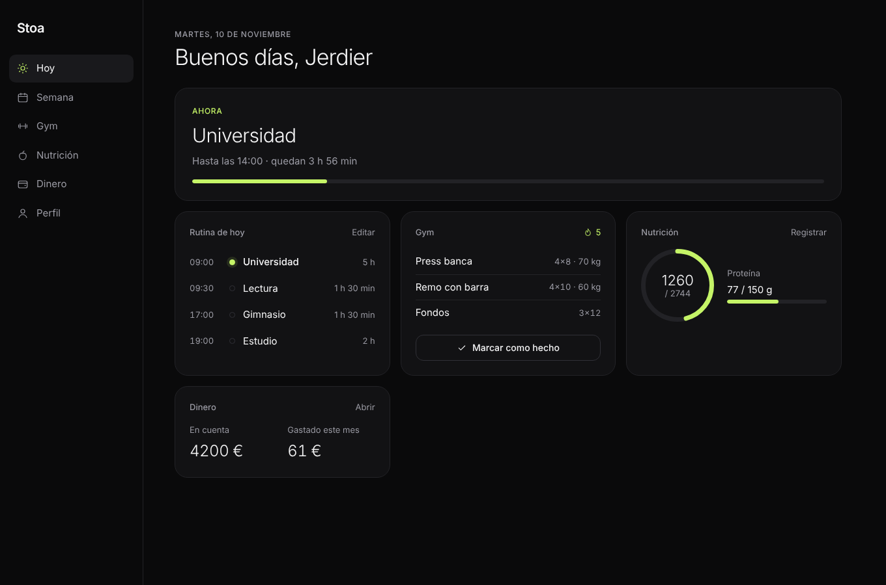
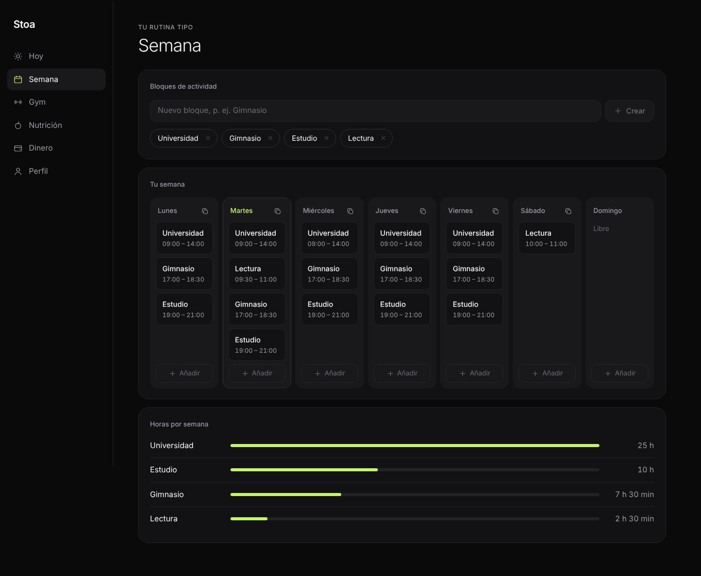
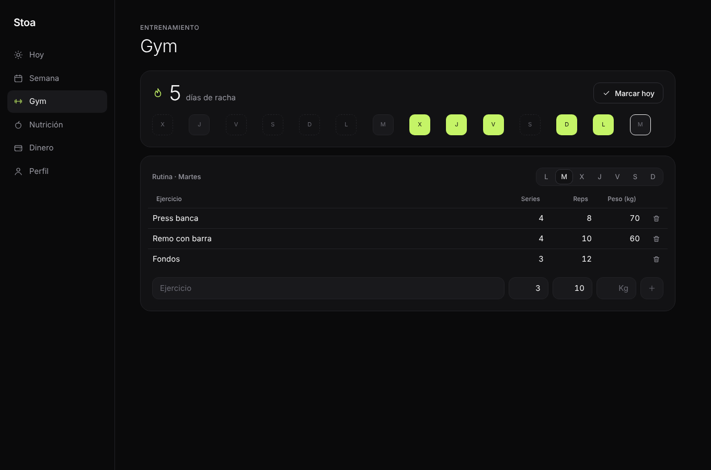
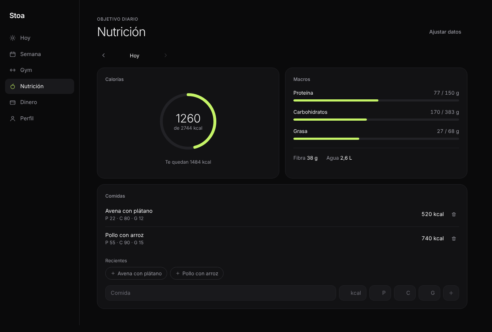
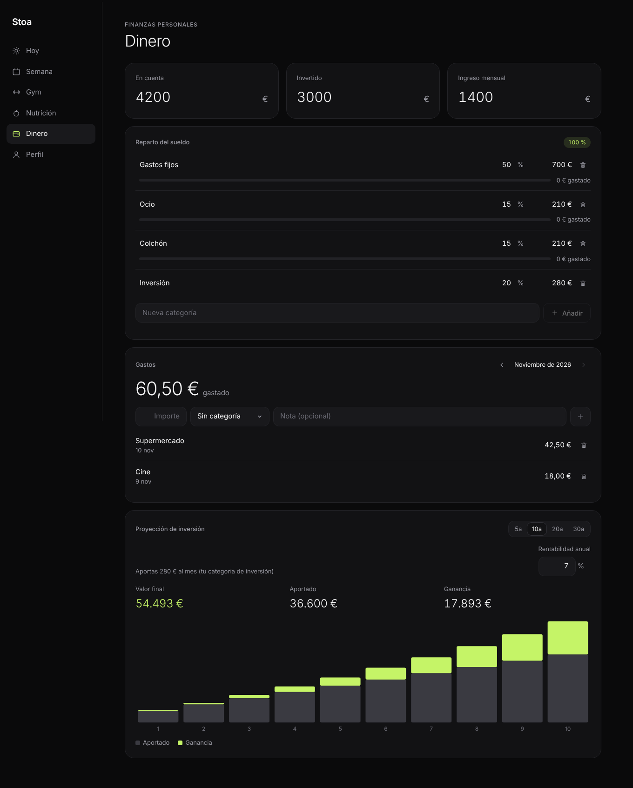
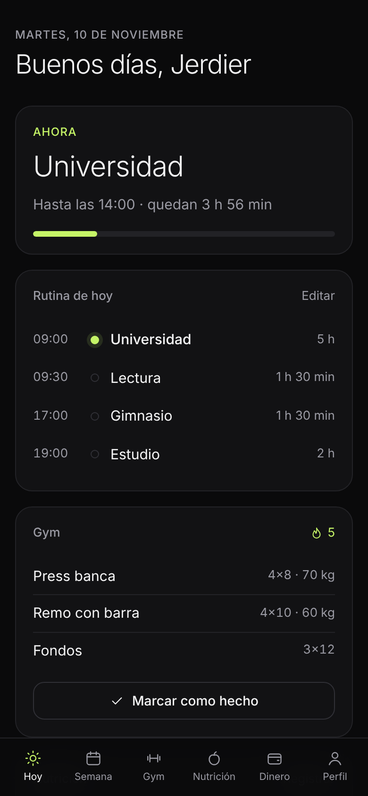

# Stoa · Planificador semanal

Planificador personal minimalista: rutina semanal por bloques de actividad, gym con racha, nutrición con objetivos calculados y finanzas con proyección de inversión. Con cuentas de usuario, base de datos real y amigos.

**Stack:** React 19 · Vite · Supabase (PostgreSQL, Auth, API REST, Row Level Security) · Vercel

## Funciones

| Sección | Qué hace |
|---|---|
| **Hoy** | Bloque actual con tiempo restante, rutina del día en línea temporal, entrenamiento del día, calorías y dinero del mes |
| **Semana** | Rutina genérica en horizontal. Creas tus bloques (Estudio, Gimnasio…) y los colocas en tramos de 30 min. Aviso de solapes, copiar un día a otros y horas por bloque |
| **Gym** | Ejercicios por día editables en la tabla, marcar el día como hecho y racha (los días de descanso no la rompen) |
| **Nutrición** | Calorías y macros según sexo, edad, peso, altura, actividad y objetivo (Mifflin-St Jeor). Registro de comidas por día y recientes con un toque |
| **Dinero** | Saldo, invertido e ingreso; reparto del sueldo por porcentajes; gastos por mes y categoría; proyección con interés compuesto |
| **Perfil** | Nombre, código de amigo, privacidad de la rutina (privada, amigos, pública), amigos por #código, tema claro u oscuro, borrar cuenta |

También es instalable como app (PWA) en el móvil y funciona en tema oscuro y claro.

## Arquitectura

```
Navegador (React)
   │  supabase-js  →  API REST generada por Supabase (PostgREST)
   ▼
PostgreSQL ── Row Level Security: cada consulta se filtra por auth.uid()
   ▲
Supabase Auth (registro, login, recuperar contraseña)
```

- No hay servidor propio: la API REST la genera Supabase a partir de las tablas.
- La seguridad está en la base de datos: las políticas RLS de `supabase/schema.sql` garantizan que cada usuario solo lee y escribe sus filas. La rutina de otra persona solo se puede leer si `can_view()` lo permite según su privacidad y vuestra amistad.
- Un trigger crea el perfil al registrarse y genera el código de amigo.

## Estructura

```
src/
  App.jsx              sesión: setup, login o app
  components/          Shell (navegación), Auth, WeekGrid, ui, icons
  pages/               Hoy, Semana, Gym, Nutricion, Dinero, Perfil
  lib/
    supabase.js        cliente
    hooks.js           useRows / useSingle: lectura y escritura de tablas
    calc.js            racha, objetivos nutricionales, proyección
    utils.js           fechas, horas, formato de euros
supabase/schema.sql    tablas, trigger, RLS y funciones
docs/GUIA.md           guía paso a paso para montarlo y desplegarlo
```

## Ejecutar en local

```bash
npm install
cp .env.example .env   # y pon tu URL y clave de Supabase
npm run dev
```

La guía completa, desde crear la base de datos hasta publicarlo en Vercel, está en [docs/GUIA.md](docs/GUIA.md).

## Capturas

| Hoy | Semana |
|---|---|
|  |  |
| **Gym** | **Nutrición** |
|  |  |
| **Dinero** | **Móvil** |
|  |  |

_Capturas con datos de ejemplo._
